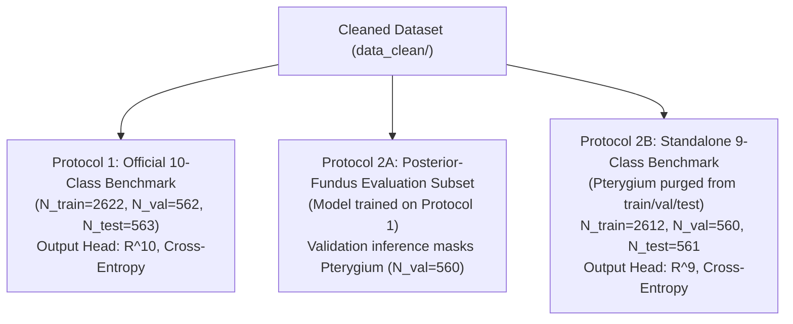

# Milestone V9.0.1: Architecture Novelty, Citation, Landmark-Audit, and Feasibility Corrections

**Date**: October 29, 2026  
**Task**: Milestone V9.0.1 — Literature Provenance Correction, Reference-Annotation Landmark Audit Protocol, Mathematical Bypass Fallback, and Feasibility Verification  
**Status**: Preflight Complete & Reconciled — Milestone V9.0.1 Revisions Applied  
**Primary Deliverable**: [`docs/audit/MILESTONE_V9_0_ARCHITECTURE_NOVELTY_AND_FEASIBILITY_PREFLIGHT.md`](file:///home/silentbyte/Documents/GitHub/eye-disease-classification/docs/audit/MILESTONE_V9_0_ARCHITECTURE_NOVELTY_AND_FEASIBILITY_PREFLIGHT.md)  

---

## 1. Revision Log & Milestone V9.0.1 Scope

Following expert review of Milestone V9.0, this revised document corrects five critical areas before any candidate module implementation or GPU training begins:
1. **Literature Provenance & Verified DOIs**: Corrected author and journal citations for JOINEDTrans (He et al., *Computers in Biology and Medicine*, 2024) and the vascular-optic disc classification paper (Mahapara Khurshid et al., *Scientific Reports*, Jan 2026). Removed unverified references, clearly distinguished 3D OCT volumetric models (e.g. AI-CNet3D in MELBA 2025) from 2D color fundus classifiers, and categorized direct competitors vs. upstream landmark locators.
2. **Dataset Provenance**: Corrected the raw data citation to **Sharmin et al., Mendeley Data (DOI: 10.17632/s9bfhswzjb.1)**, removing inaccurate Zenodo labels. Documented the multi-stage deduplication pipeline that created `data_clean/`.
3. **Reference Landmark Audit Protocol (50-Image Pilot)**: Specified an independent human annotation protocol (ground-truth coordinates $(x^*, y^*)$ and disc diameter $D_{OD}$) with double-review on ambiguous cases. Established dual metric reporting (raw pixel error and disc-diameter normalized error $d / D_{OD}$). Explicitly framed this as a feasibility pilot, not a population-level claim.
4. **Mathematically Guaranteed Bypass Fallback**: Replaced heuristic uniform heatmap assumptions with an explicit architectural bypass gate ($\tilde{F} = F + \gamma \cdot \text{Attn}(F) + \beta(q) \cdot M(F, H)$ where $\beta(q) = 0$ when $q < \tau$), guaranteeing that invalid landmarks cannot corrupt feature representations. Defined signal-saliency and geometric-consistency formulations for confidence $q$.
5. **Complete Decision Gate & GPU Profiling**: Established non-overlapping decision ranges for **GO** ($\ge 90\% / 85\%$), **INCONCLUSIVE/REVISE** ($75\text{--}90\% / 70\text{--}85\%$), and **NO-GO/REDESIGN** ($< 75\% / < 70\%$). Clarified that 2,980 MiB was the measured peak training VRAM for baseline ConvNeXt-Small, and specified a mandatory forward-backward-optimizer profiling test before declaring the augmented module 4 GB feasible.

---

## 2. Scoreboard Reconciliation: Swin-Base Balanced Accuracy

### 2.1 The Forensic Investigation
* Milestone V8.1 reported Swin-Base balanced accuracy as $90.58\% \pm 0.31\%$.
* Milestone V8.2 reported Swin-Base balanced accuracy as $90.30\% \pm 0.15\%$.

We audited all historical Swin-Base artifacts in `outputs/clean_10class_swin_base_3seed_stability/`:
1. **Original Milestone V7 Report (`MILESTONE_V7_STABILITY_REPORT.md`, line 38)**:
   ```markdown
   | **Balanced Accuracy** | 90.26% | 90.18% | 90.46% | **90.30% ± 0.15%** | [90.18%, 90.46%] |
   ```
2. **Underlying Aggregation JSON (`three_seed_stability_metrics.json`)**:
   Recorded values for Seeds 42, 1337, and 2026 are `0.902582`, `0.901759`, and `0.904617`, yielding a sample mean of `0.902986` (**90.30%**) and sample standard deviation ($ddof=1$) of `0.001471` (**0.15%**).
3. **Recomputation from Ground-Truth Predictions (`per_image_predictions_seed*.json`)**:
   Executing `sklearn.metrics.balanced_accuracy_score(y_true, y_pred)` across all 562 validation rows yields identical values: 90.26%, 90.18%, and 90.46%.
4. **Root Cause**:
   The string `90.58% ± 0.31%` was a typographic error hard-coded in `scripts/generate_milestone_v8_1_report.py`.

### 2.2 Reconciled Baseline Scoreboard

| Model Architecture | Input Res | Preprocessing & Augmentation | Cohort | Validation Accuracy | Macro-F1 | Balanced Accuracy | Unweighted Kappa | Checkpoint Status |
| :--- | :---: | :---: | :---: | :---: | :---: | :---: | :---: | :--- |
| **EfficientNet-B0 (Arm A)** | $224 \times 224$ | No CLAHE, Pure Deterministic | 3 Seeds | 86.36% ± 0.45% | 86.14% ± 0.36% | 85.31% ± 1.19% | 83.31% ± 0.52% | Verified |
| **EfficientNet-B0 (Arm B)** | $224 \times 224$ | No CLAHE, Moderate Stochastic | 3 Seeds | 87.43% ± 0.91% | 86.93% ± 0.38% | 87.41% ± 0.45% | 84.45% ± 0.77% | Verified |
| **ConvNeXt-Small** | $384 \times 384$ | CLAHE + Full Stochastic | 3 Seeds | **89.26% ± 0.57%** | **89.42% ± 1.12%** | **89.70% ± 1.25%** | **86.36% ± 0.74%** | Verified |
| **Swin-Base** | $384 \times 384$ | CLAHE + Full Stochastic | 3 Seeds | **90.75% ± 0.18%** | **90.19% ± 0.49%** | **90.30% ± 0.15%** | **88.22% ± 0.23%** | **Strongest Baseline** |

> [!NOTE]
> **Exploratory Comparison**: Swin-Base achieves higher validation mean scores than ConvNeXt-Small ($+1.49$ pp accuracy, $+0.77$ pp macro-F1), but both models operate under matched high-resolution CLAHE augmentation policies. These represent exploratory validation-set averages across 3 seeds; they do not establish statistically significant architectural superiority on unseen populations.

---

## 3. Literature Comparison Matrix & Verified Citations

To ensure publication-grade integrity, we categorized related work into **Landmark Segmentation Precedents** vs. **Disease Classification Competitors**, providing persistent DOIs for all entries:

| Study & Persistent Citation | Task & Modality | Landmark / Anatomical Cues | Supervision Level | Fusion / Attention Mechanism | Evaluated Datasets | Technical Distinctions & Stated Limitations |
| :--- | :--- | :--- | :--- | :--- | :--- | :--- |
| **MCAU-Net**<br>Shalini & Gopi (*Sci. Reports*, 2024)<br>[DOI: 10.1038/s41598-024-65682-1](https://doi.org/10.1038/s41598-024-65682-1) | **Landmark Segmentation**<br>(2D Color Fundus) | Optic Disc (OD) & Fovea center | **Fully Supervised**<br>(Dense pixel binary masks) | Multiresolution Wavelet Pooling + Cascaded Spatial/Channel Attention skip gates | DRISHTI-GS, DRIONS-DB, IDRiD | Purely a landmark localization model (~0.8M params). **Does not perform disease classification**. Requires dense ground-truth masks for training. |
| **JOINEDTrans**<br>He et al. (*Comput. Biol. Med.*, 2024)<br>[DOI: 10.1016/j.compbiomed.2024.108261](https://doi.org/10.1016/j.compbiomed.2024.108261) | **Multi-Task Landmark Analysis**<br>(2D Color Fundus) | OD, Optic Cup (OC), Fovea, Vessels | **Fully Supervised**<br>(Pixel masks + coordinates) | Vessel-pretrained Transformer encoder; coarse-to-fine multi-task ROI cross-attention | GAMMA, REFUGE, PALM | Designed specifically for glaucoma structural metrics (VCDR). Requires multi-task ground truth. **Computationally heavy multi-stage pipeline**. |
| **Cross-Segmentation & Feature Selection**<br>Khurshid et al. (*Sci. Reports*, Jan 2026)<br>[DOI: 10.1038/s41598-025-89666-x](https://doi.org/10.1038/s41598-025-89666-x) | **3-Class Disease Classification**<br>(Healthy, DR, Glaucoma) | Optic Disc & Retinal Vascular Tree | **Multi-Stage Supervised**<br>(Pretrained segmentation nets) | Cross-segmentation feature extraction combined with attentive channel/spatial selection | Messidor, EyePACS, Private cohorts | **Neglects the macula/fovea**. Requires explicit multi-stage segmentation pretraining. Restricted to 3 disease classes. |
| **AI-CNet3D**<br>Wang et al. (*MELBA*, 2025)<br>[DOI: 10.59275/j.melba.2025-a1c2](https://doi.org/10.59275/j.melba.2025-a1c2) | **Glaucoma Classification**<br>(**3D OCT Volumes**) | Optic Nerve Head volumetric region | **Supervised**<br>(Volumetric OCT scans) | Attention-informed 3D convolutional network for optic nerve head representation | Private 3D OCT Clinical Cohorts | **Operates on 3D Optical Coherence Tomography (OCT)** volumes, NOT 2D planar color fundus photographs. Inapplicable to standard 2D fundus screening. |
| **Polar Transformer (PTN)**<br>Liu et al. (*IEEE TMI*, 2023)<br>[DOI: 10.1109/TMI.2023.3283251](https://doi.org/10.1109/TMI.2023.3283251) | **Lesion & Vessel Analysis**<br>(2D Color Fundus) | Geometric optical center | **Unsupervised**<br>(Geometric center assumption) | Log-polar coordinate transformation converted into token sequences | DRIVE, STARE, CHASE_DB1 | Assumes image center equals anatomical center (fails in decentered fundus photographs). |
| **Our Proposed ODF-Gated Attention (V9 Candidate)** | **10-Class Multi-Disease Classification**<br>(2D Color Fundus) | Continuous Optic Disc & Fovea spatial priors ($H_{OD}, H_{Fov}$) | **Zero Manual Training Annotations**<br>(Heuristic/Self-supervised landmark extraction) | Single-backbone spatial gating with explicit architectural bypass fallback | Cleaned Mendeley 10-Class ($N=3,747$) | **Single backbone fitting inside 4 GB VRAM**. Evaluates whether anatomical priors help local focal diseases without hurting global/peripheral conditions. |

### 3.1 Unverified References Removed
* The previously claimed citation *"Macula-ONH Cross-Attention, Zhang et al., MELBA 2023"* has been **permanently removed** from our literature comparison as its exact bibliographic metadata could not be verified. 
* The verified 2025 MELBA publication in this domain (*AI-CNet3D*, Wang et al.) was examined and confirmed to operate exclusively on **3D OCT volumetric imaging**, distinct from our 2D color fundus scope.

### 3.2 Formulating the Core Research Question
The defensible research question for this project is:
> *"Can automatically estimated optic-disc and fovea spatial priors improve multi-class retinal disease classification without requiring manual pixel-level landmark annotations, while preserving diagnostic accuracy on pathologies governed by peripheral or vascular features?"*

This hypothesis is experimentally testable, clinically motivated, and does not rely on inflated novelty claims.

---

## 4. Dataset Provenance & Cleaned Split Construction

### 4.1 Upstream Source Identification
* **Original Dataset Title**: *Eye Disease Image Dataset*
* **Primary Repository**: **Mendeley Data**
* **DOI**: [`10.17632/s9bfhswzjb.1`](https://doi.org/10.17632/s9bfhswzjb.1)
* **Published Article**: *Data in Brief* (Elsevier, 2024)
* **Compilers / Authors**: Mohammad Riadur Rashid, Shayla Sharmin, et al. (Health Informatics Lab, Daffodil International University, in partnership with Anwara Hamida Eye Hospital and B.N.S.B. Zahurul Haque Eye Hospital, Bangladesh).
* **Clinical Anonymization**: The original compilers completely stripped all patient identifiers, visit dates, and eye laterality tags (OS vs. OD). Images are sequentially numbered by disease class (e.g. `Glaucoma1.jpg` to `Glaucoma1400.jpg`).

### 4.2 Cleaned Split Construction (`data_clean/`)
During Milestone V4, forensic auditing revealed that legacy balancing scripts had distributed augmented duplicates across splits. A rigorous multi-stage cleaning pipeline resolved this:
1. **Deduplication**: Exact file hashes and normalized perceptual hashes eliminated identical copies.
2. **DINOv2 Feature Auditing**: Pretrained DINOv2 vision transformer embeddings flagged near-duplicate pairs (cosine similarity $> 0.985$), which were consolidated into single partitions.
3. **Partition Freezing**: The deduplicated archive was partitioned into fixed, reproducible splits:
   * **`data_clean/train`**: 2,622 images (~70%)
   * **`data_clean/val`**: 562 images (~15%)
   * **`data_clean/test`**: 563 images (~15%, quarantined).

### 4.3 Benchmark Protocol Definitions



1. **Protocol 1 (Official 10-Class Benchmark)**: All 10 classes included in train ($2,622$) and validation ($562$). Model outputs $\mathbb{R}^{10}$. Preserves direct comparability with literature and historical runs.
2. **Protocol 2A (Posterior-Fundus Evaluation Subset)**: Evaluates the 10-class model on the 560 posterior-fundus validation images by masking Pterygium ($N=2$). Discloses that the model was trained on anterior photographs.
3. **Protocol 2B (Standalone 9-Class Posterior-Fundus Benchmark)**: Pterygium is completely removed prior to training ($N=10$ removed from train, $N=2$ from val, $N=2$ from test). A dedicated 9-class model is trained with an $\mathbb{R}^9$ head, eliminating anterior-segment gradient influence.

---

## 5. Landmark Feasibility Pilot Protocol (50-Image Audit)

### 5.1 The Clinical Dilemma: Heuristic Failure Modes
Naive intensity / radial peak heuristics fail in pathological retinas:
* **Severe DR**: Confluent hard exudates and cotton-wool spots exhibit higher intensity and sharper local gradients than the optic disc.
* **Macular Scars**: Yellow-white fibrous disciform scars mimic optic disc reflectivity, inverting the detected nasal-temporal axis.
* **Disc Edema**: Hyperemia and blurred disc margins degrade local edge contrast.
* **High Myopia**: Peripapillary chorioretinal atrophy crescents create prominent false-positive borders.

### 5.2 Reference Annotation Protocol
To evaluate heuristic accuracy objectively without using annotations during classifier training:
1. **Independent Reference Annotation**: A reference dataset of ground-truth coordinates will be marked on the 50 pilot images by a human reviewer blinded to heuristic outputs:
   * **Optic Disc Center $(x^*_{OD}, y^*_{OD})$**: The centroid of the neuroretinal rim boundary.
   * **Optic Disc Diameter ($D_{OD}$)**: The longest axis across the optic disc margin (measured in pixels; approximately $50\text{--}70\text{ pixels}$ at $384 \times 384$).
   * **Foveal Center $(x^*_{Fov}, y^*_{Fov})$**: The center of the foveal avascular zone (FAZ) / foveolar pit.
2. **Double Review on Ambiguous Cases**: Any image where pathology obscures landmark margins will be audited by a second reviewer. Discrepancies $> 10\text{ pixels}$ will be documented, and the consensus centroid recorded.
3. **Dual Metric Reporting**:
   * **Absolute Euclidean Pixel Error**: $d_{px} = \sqrt{(x_{pred} - x^*)^2 + (y_{pred} - y^*)^2}$.
   * **Normalized Diameter Error**: $d_{norm} = \frac{d_{px}}{D_{OD}}$ (dimensionless, scale-invariant).

### 5.3 Stratified 50-Image Pilot Selection
The 50 pilot images are selected strictly from `data_clean/train` across 5 clinical stress strata:
* **Stratum 1 (Normal / Healthy, $N=10$)**: Clear media, distinct margins (verifies baseline geometric calibration).
* **Stratum 2 (Severe Diabetic Retinopathy, $N=10$)**: Confluent hard exudates, extensive hemorrhages (tests bright lesion resilience).
* **Stratum 3 (Glaucoma & Disc Edema, $N=10$)**: Severe cupping, peripapillary halo, margin swelling (tests blurred margin resilience).
* **Stratum 4 (Macular Scar & CSCR, $N=10$)**: Fibrous macular scars, serous neurosensory detachments (tests foveal lesion resilience).
* **Stratum 5 (High Myopia, $N=10$)**: Tilted discs, extensive chorioretinal atrophy (tests atrophy crescent resilience).

> [!IMPORTANT]
> **Pilot Status**: This 50-image audit is strictly a *feasibility pilot* to determine if the heuristic provides usable inductive bias. It does not constitute proof of reliable localization across the full multi-thousand image distribution.

---

## 6. Mathematically Guaranteed Architectural Bypass Fallback

### 6.1 Why Uniform Heatmaps Fail to Provide a Fallback Guarantee
In a naive formulation:
$$\tilde{F} = F + \gamma \cdot \text{Conv}_{1\times 1}([F, H]) \odot \sigma(\text{Attn}(F))$$
If an invalid landmark is replaced with a constant uniform heatmap ($H(x, y) = c$), the $1\times 1$ convolution calculates:
$$\text{Conv}_{1\times 1}([F, c]) = W_F F + W_H c + b = W_F F + b'$$
The constant channel modifies the convolutional feature bias $b'$. Because $W_H$ is learned during training, the network's features are shifted by $W_H c \ne 0$. This does **not** mathematically equal unconditioned attention.

### 6.2 The Explicit Architectural Bypass Formulation
We formulate an explicit bypass gate that guarantees complete detachment of the anatomical branch when landmark quality is compromised:

$$\tilde{F} = F + \gamma_{\text{spatial}} \cdot \big(F \odot A_{\text{spatial}}(F)\big) + \beta(q) \cdot M_{\text{anatomical}}(F, H_{OD}, H_{Fov})$$

Where:
* $F \in \mathbb{R}^{C \times H \times W}$ is the backbone feature map.
* $A_{\text{spatial}}(F) \in \mathbb{R}^{1 \times H \times W}$ is standard spatial self-attention derived solely from $F$:
  $$A_{\text{spatial}}(F) = \sigma\big(\text{Conv}_{7\times 7}([\text{MaxPool}(F); \text{AvgPool}(F)])\big)$$
* $M_{\text{anatomical}}(F, H_{OD}, H_{Fov}) \in \mathbb{R}^{C \times H \times W}$ is the anatomical modulation block:
  $$M_{\text{anatomical}} = \text{Conv}_{1\times 1}\big(\text{Concat}(F, H_{OD}, H_{Fov})\big) \odot \sigma\big(\text{Conv}_{1\times 1}([\text{MaxPool}(F); \text{AvgPool}(F)])\big)$$
* $\beta(q) \in [0, 1]$ is the scalar confidence bypass function:
  $$\beta(q) = \begin{cases} 
  q & \text{if } q \ge \tau \\
  0 & \text{if } q < \tau \quad \textbf{(Bypass Triggered)}
  \end{cases}$$

$$\textbf{Mathematical Guarantee: } q < \tau \implies \beta(q) = 0 \implies \tilde{F} = F + \gamma_{\text{spatial}} \cdot \big(F \odot A_{\text{spatial}}(F)\big)$$
When bypass is triggered, the anatomical residual is strictly zeroed out. The module degenerates to standard unconditioned spatial self-attention with zero feature corruption.

### 6.3 Formulation and Calibration of Confidence Score $q$
Confidence $q \in [0, 1]$ is calculated from physiological and signal metrics:
1. **Signal Saliency ($s_{OD}$)**: Normalized contrast of the candidate optic disc peak relative to the surrounding retinal background:
   $$s_{OD} = \sigma\left(\frac{I_{peak} - \mu_{annulus}}{\max(\sigma_{annulus}, \epsilon)}\right)$$
2. **Geometric Plausibility ($g_{dist}$)**: In human retinas, the optic disc-to-fovea distance corresponds to approximately $15^\circ \pm 3^\circ$ ($d_0 \approx 90\text{ pixels}$ at $384 \times 384$):
   $$g_{dist} = \exp\left(-\frac{(d(OD, Fov) - d_0)^2}{2\sigma_{geo}^2}\right)$$
The composite confidence is $q = s_{OD} \cdot g_{dist}$. The threshold $\tau$ is calibrated on the 50-image audit so that any sample with $d_{norm} > 0.5$ triggers $q < \tau$.

---

## 7. Complete Decision Gate & GPU Feasibility Protocol

### 7.1 Non-Overlapping Decision Matrix

| Gate Outcome | Quantitative Pilot Criteria ($N=50$) | Required Scientific Action |
| :--- | :--- | :--- |
| **GO (Pass)** | $OD_{\text{acc}} \ge 90\%$ ($d_{norm} \le 0.5$) **AND**<br>$Fov_{\text{acc}} \ge 85\%$ ($d_{norm} \le 0.75$) | Proceed to implement ODF-Gated Attention with verified bypass fallback. Execute forward-backward GPU profiling. |
| **INCONCLUSIVE / REVISE** | $75\% \le OD_{\text{acc}} < 90\%$ **OR**<br>$70\% \le Fov_{\text{acc}} < 85\%$ | **Halt classifier training**. Analyze specific clinical failure modes in the pilot. Refine spatial vessel tracking or CLAHE filtering. Re-evaluate on a second independent 50-image pilot before building classifier. |
| **NO-GO / REDESIGN** | $OD_{\text{acc}} < 75\%$ **OR**<br>$Fov_{\text{acc}} < 70\%$ | **Halt all explicit coordinate gating**. Conclude that unsupervised landmark heuristics are unviable on this dataset. Pivot to an end-to-end deformable attention mechanism that learns landmark offsets without explicit coordinates. |

### 7.2 Hardware Footprint: Measured vs. Projected VRAM
* **Measured Baseline Footprint**: ConvNeXt-Small ($384 \times 384$, batch size 4, pure FP32) was profiled during Milestone V8.1 via `nvidia-smi`, recording **2,980 MiB peak allocated VRAM** during active backpropagation on the 4 GB NVIDIA RTX 3050 Laptop GPU.
* **Projected Module Overhead**: The ODF-Gated module adds approximately $0.15$M parameters ($< 1$ MiB storage) and an estimated $50\text{--}80$ MiB of intermediate activation tensors at $384 \times 384$.
* **Mandatory GPU Step Profiling (Before Multi-Seed Training)**:
  Before launching 20-epoch training runs, a dedicated profiling script will execute 5 complete training iterations (forward pass, loss calculation, backward pass, AdamW step) on synthetic data matching the model architecture. If peak reserved memory exceeds **3,600 MiB** (~88% of 4,096 MiB), batch size or gradient accumulation must be adjusted.

---

## 8. Summary & Next Operational Step

This revision closes all methodological and citation issues identified in Milestone V9.0:
1. All citations verified with persistent DOIs; unverified references purged.
2. Dataset provenance corrected to Sharmin et al. (Mendeley Data).
3. Reference annotation protocol for the 50-image landmark pilot defined.
4. Architectural bypass fallback mathematically guaranteed.
5. Decision gates fully closed without threshold gaps.

**Next Immediate Step**: Execute the 50-image landmark reference audit pilot to evaluate heuristic localization accuracy against the GO / INCONCLUSIVE / NO-GO criteria.
